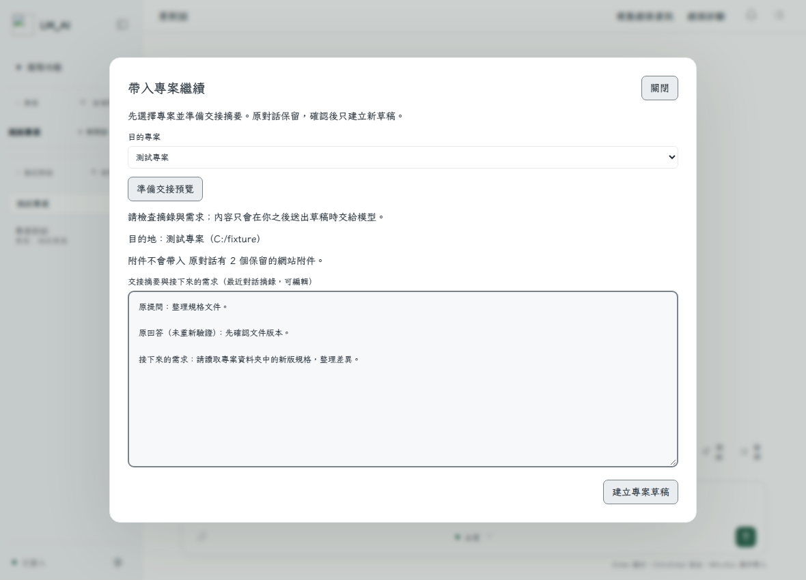

# LM_AI — Windows 工作助理

LM_AI 連接公司 AI 服務，協助問答、文件整理、Office 副本修訂、Python 分析與 Classic Outlook 郵件分析。支援 Windows 11 x64。

**目前版本：0.9.7。建置與驗證結果見本版紀錄；公司環境另行驗收。**

成品校驗：[Releases與SHA256](https://github.com/you1230783-sys/CompanyAI/releases/tag/v0.9.7) · [驗證紀錄](docs/VALIDATION_0_9_7.md)。請使用下方的完整安裝包。

## 下載與安裝

1. [下載 LM_AI_Setup.exe](https://github.com/you1230783-sys/CompanyAI/releases/download/v0.9.7/LM_AI_Setup.exe)。先從托盤離開程式，以一般權限安裝到 `C:\largan\LM_AI`。
2. 開啟程式，按「登入」，在瀏覽器核對短碼並授權。
3. 一般提問可直接對話；處理文件時選擇「我的工作區」或建立專案。

安裝包內含 Python，請保留完整安裝目錄。WebView2 Runtime 另依 [離線說明](dist/WEBVIEW2-OFFLINE.md) 安裝。使用者不需安裝 Rust 或 Node。

程式內更新仍從公司伺服器取得並驗證簽章與同源網址。GitHub僅為目前手動下載入口。公司模型、真實Outlook及公司加密文件仍須公司環境驗收；請查看 [0.9.7驗證紀錄](docs/VALIDATION_0_9_7.md)。

## 主要功能

- 一般對話、附件、截圖提問與可分享的指令範本。
- 對話交接至專案、統一最近對話與依工具紀錄產生的任務總覽。
- 預設工作區、Word翻譯／原樣式副本、Word／Excel比較與Markdown新建。
- 回答／對話匯出Word及PDF，已保存流程的定時提醒與手動啟動。
- Python／LOG分析、圖表、流程圖與週報。
- Classic Outlook唯讀分析、有限CAD操作及選用VNC入口。

完整範圍見 [功能表](docs/FEATURES.md)；操作見 [使用指南](docs/USER_GUIDE.md)。

## 文件與維護

- [更新紀錄](CHANGELOG.md) · [分版實作計畫](docs/IMPLEMENTATION_PLAN.md)
- [開發說明](docs/DEVELOPMENT.md) · [技術索引](docs/README.md)
- [錯誤與診斷](docs/ERROR_CODES.md) · [核心回歸清單](docs/CORE_REGRESSION.md)

本機介面資源隨EXE提供，不依賴CDN。建置固定Rust工具鏈與MSVC v142 x64；Git保留Cargo.toml／Cargo.lock與專案.cargo設定，vendor及建置工具另行準備；不再使用Git LFS。維護前請讀 [AGENTS.md](AGENTS.md)。
